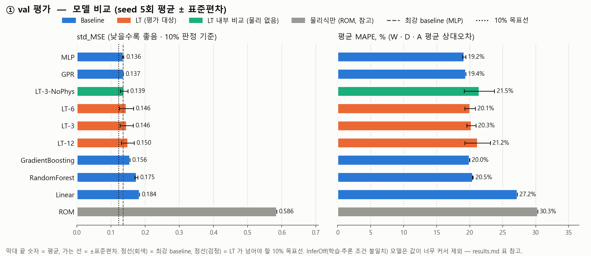
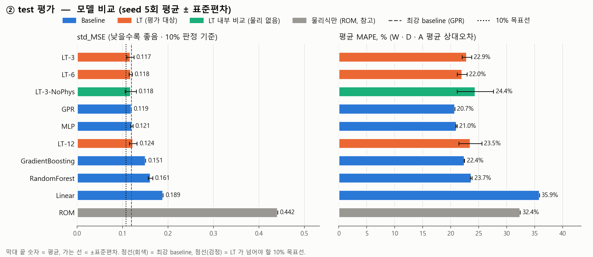
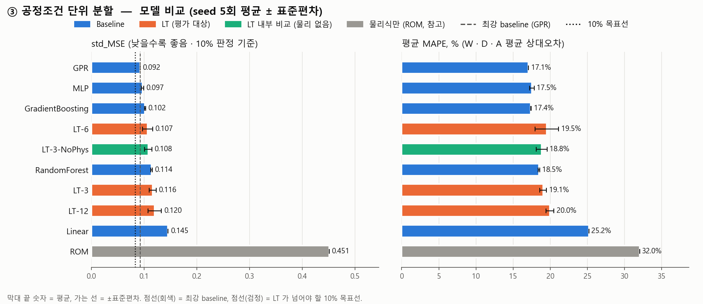
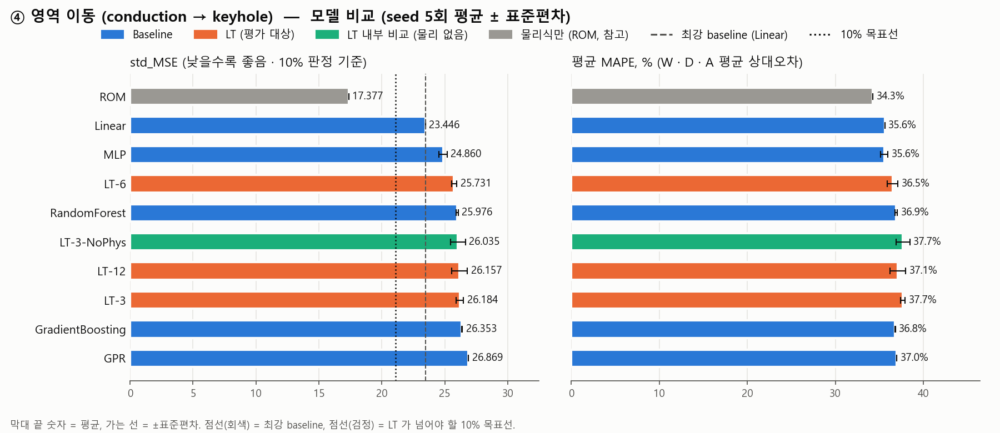

# Baseline 비교 결과 (4가지 평가 통합)

## 평가 방식 한눈에
| 평가 | 설명 |
|---|---|
| ① val | 기준이가 나눈 방식 그대로 train 473개로 학습하고 val 101개로 채점. 지금까지 해온 기본 비교 |
| ② test | 같은 train 으로 학습하고, 한 번도 쓰지 않은 test 103개로 채점. val 결과가 우연히 그 시험지에만 잘 맞은 것은 아닌지 확인 |
| ③ 공정조건 단위 분할 | 같은 조건(P, v, d, t)으로 두 번 실험한 쌍이 train/test 에 나뉘지 않게 묶어서 분할. 거의 같은 문제를 미리 보고 맞히는 효과를 뺀 엄격한 평가 |
| ④ 영역 이동 | 얕은 용융풀(conduction, D/W < 0.5)로만 학습하고 깊은 용융풀(keyhole, D/W ≥ 0.5)로 채점. 처음 보는 영역에서도 예측이 버티는지(외삽) 보는 가장 어려운 평가 |

## 공통 실험 조건
- 입력 7개 (P, v, d, t, E_L, Pe, H*) → 출력 3개 (W, R = D/W, A). 표준화 기준은 각 평가의 train 으로만 계산
- 반복: 모델 seed 0~4 로 5회 → 평균 ± 표준편차 (데이터 분할은 평가마다 고정)
- 신경망(MLP, LT): AdamW, lr 1e-3, batch 64, 100 epoch 고정 (평가 데이터로 best epoch 를 고르지 않음)

## 지표
| 지표 | 뜻 |
|---|---|
| std_MSE | 표준화 공간의 평균제곱오차 (W · R · A 평균). 단위가 없어 항목을 합칠 수 있음 → **10% 판정 기준** |
| MAPE (%) | 평균 상대오차. mean_MAPE = W · D · A 의 MAPE 평균 |
| MAE | 평균 절대오차 (W, D: um / A: um^2) |
| 개선률 (%) | (baseline std_MSE − LT std_MSE) / baseline std_MSE × 100. **10 이상이면 목표 달성** |

## 모델
| 모델 | 어떤 모델인가 | 비고 |
|---|---|---|
| Linear | 입력의 가중합으로 예측하는 가장 단순한 기준선 | 무작위성 없음 |
| RandomForest | 결정트리 여러 개의 예측을 평균 | scikit-learn 기본값 |
| GradientBoosting | 앞 트리의 오차를 다음 트리가 보완하며 쌓음 | W, R, A 각각 별도 모델 |
| GPR | 비슷한 입력 → 비슷한 출력 가정(kernel). 소량 데이터에 강함 | RBF + 노이즈 |
| MLP | 3층 신경망 (기준이 `StateMLP`) | LT 와 같은 학습 설정 |
| ROM | 학습 없이 물리식만으로 계산 (Rosenthal W, H*·Pe 깊이, 반타원 A) | 참고용 |
| LT-k | Looped Transformer, loop k 회. 학습 · 추론 모두 물리 피드백 | **평가 대상** |
| LT-3-NoPhys | 학습 · 추론 모두 물리 피드백 없음 | 내부 비교: LT-3 과의 차이 = 물리 피드백 효과 |
| LT-k-InferOff | 학습은 물리 피드백, 추론은 끔 (`interfaceLT.py` 방식) | 조건 불일치 참고용 (① 에서만 실행) |

## 평가 방식 4가지

| 평가 | train | 평가 데이터 | 확인하는 것 |
|---|---|---|---|
| ① val 평가 | 473 | 101 | 기본 비교 (기준이 분할) |
| ② test 평가 | 473 | 103 | val 에만 맞춰진 결과가 아닌지 (한 번도 안 쓴 데이터) |
| ③ 공정조건 단위 분할 | 470 | 104 | 같은 조건 반복 실험을 외워서 맞히는 효과를 뺀 성능 |
| ④ 영역 이동 (conduction → keyhole) | 342 | 335 | 처음 보는 영역에서도 버티는지 (외삽) |

## 종합 1: 평가별 std_MSE (낮을수록 좋음, 평균 ± 표준편차)

| model | ① val 평가 | ② test 평가 | ③ 공정조건 단위 분할 | ④ 영역 이동 (conduction → keyhole) |
|---|---|---|---|---|
| Linear | 0.184 ± 0.000 | 0.189 ± 0.000 | 0.145 ± 0.000 | 23.446 ± 0.000 |
| RandomForest | 0.175 ± 0.004 | 0.161 ± 0.005 | 0.114 ± 0.002 | 25.976 ± 0.075 |
| GradientBoosting | 0.156 ± 0.000 | 0.151 ± 0.000 | 0.102 ± 0.001 | 26.353 ± 0.033 |
| GPR | 0.137 ± 0.000 | 0.119 ± 0.000 | 0.092 ± 0.000 | 26.869 ± 0.000 |
| MLP | 0.136 ± 0.002 | 0.121 ± 0.002 | 0.097 ± 0.002 | 24.860 ± 0.326 |
| ROM | 0.586 ± 0.000 | 0.442 ± 0.000 | 0.451 ± 0.000 | 17.377 ± 0.000 |
| LT-3 | 0.146 ± 0.019 | 0.117 ± 0.008 | 0.116 ± 0.007 | 26.184 ± 0.292 |
| LT-6 | 0.146 ± 0.020 | 0.118 ± 0.004 | 0.107 ± 0.010 | 25.731 ± 0.212 |
| LT-12 | 0.150 ± 0.019 | 0.124 ± 0.009 | 0.120 ± 0.013 | 26.157 ± 0.638 |
| LT-3-NoPhys | 0.139 ± 0.011 | 0.118 ± 0.012 | 0.108 ± 0.007 | 26.035 ± 0.596 |
| LT-3-InferOff | 0.190 ± 0.010 | - | - | - |
| LT-6-InferOff | 0.444 ± 0.116 | - | - | - |
| LT-12-InferOff | 1.432 ± 0.353 | - | - | - |

## 종합 2: 가장 강한 baseline 대비 LT 개선률 (%) — 10 이상이면 목표 달성

| 평가 | 최강 baseline | LT-3 | LT-6 | LT-12 |
|---|---|---|---|---|
| ① val 평가 | MLP | -7.5 | -7.1 | -10.0 |
| ② test 평가 | GPR | 1.7 | 1.1 | -3.5 |
| ③ 공정조건 단위 분할 | GPR | -25.8 | -15.6 | -30.3 |
| ④ 영역 이동 (conduction → keyhole) | Linear | -11.7 | -9.7 | -11.6 |

---

## ① val 평가
기본 비교 (기준이 분할)

### 주요 지표

| model | std_MSE | mean_MAPE | W_MAPE | D_MAPE | A_MAPE | W_MAE | D_MAE | A_MAE |
|---|---|---|---|---|---|---|---|---|
| Linear | 0.1837 ± 0 | 27.23 ± 0 | 10.14 ± 0 | 34.81 ± 0 | 36.74 ± 0 | 15.15 ± 0 | 26.73 ± 0 | 3716 ± 0 |
| RandomForest | 0.1746 ± 0.004 | 20.47 ± 0.068 | 9.911 ± 0.19 | 27.47 ± 0.22 | 24.03 ± 0.42 | 14.96 ± 0.22 | 23.75 ± 0.28 | 3408 ± 53 |
| GradientBoosting | 0.1557 ± 0.00025 | 19.99 ± 0.0079 | 9.71 ± 0.0048 | 25.71 ± 0.021 | 24.55 ± 0.012 | 14.27 ± 0.012 | 20.82 ± 0.046 | 3190 ± 1.2 |
| GPR | 0.1367 ± 0 | 19.41 ± 0 | 9.334 ± 0 | 27.33 ± 0 | 21.57 ± 0 | 14.05 ± 0 | 21.21 ± 0 | 2991 ± 0 |
| MLP | 0.136 ± 0.0019 | 19.16 ± 0.25 | 9.405 ± 0.25 | 27 ± 0.61 | 21.08 ± 0.33 | 14.02 ± 0.28 | 21.32 ± 0.34 | 2999 ± 15 |
| ROM | 0.5858 ± 0 | 30.3 ± 0 | 12.27 ± 0 | 36.45 ± 0 | 42.18 ± 0 | 19.02 ± 0 | 48.15 ± 0 | 8088 ± 0 |
| LT-3 | 0.1461 ± 0.019 | 20.27 ± 0.7 | 9.637 ± 0.46 | 27.66 ± 0.9 | 23.51 ± 1.6 | 13.9 ± 0.5 | 22.2 ± 0.99 | 3273 ± 60 |
| LT-6 | 0.1456 ± 0.02 | 20.07 ± 0.77 | 9.548 ± 0.63 | 29 ± 1.9 | 21.68 ± 0.71 | 14.04 ± 0.66 | 22.45 ± 0.99 | 3172 ± 41 |
| LT-12 | 0.1496 ± 0.019 | 21.2 ± 1.9 | 9.791 ± 0.6 | 28.65 ± 1.5 | 25.15 ± 4.7 | 14.21 ± 0.68 | 21.82 ± 0.99 | 3375 ± 2.3e+02 |
| LT-3-NoPhys | 0.1389 ± 0.011 | 21.48 ± 2.3 | 9.466 ± 0.47 | 29.58 ± 3.1 | 25.39 ± 4.7 | 13.86 ± 0.55 | 22.52 ± 1.2 | 3314 ± 1.8e+02 |
| LT-3-InferOff | 0.1902 ± 0.01 | 31.93 ± 2.3 | 14.53 ± 0.89 | 38.48 ± 4.1 | 42.8 ± 5.5 | 20.3 ± 0.93 | 26.59 ± 1.9 | 4580 ± 4.3e+02 |
| LT-6-InferOff | 0.4441 ± 0.12 | 58.7 ± 11 | 20.99 ± 2.3 | 76.69 ± 19 | 78.41 ± 15 | 30.55 ± 3.3 | 53.08 ± 12 | 8629 ± 1.3e+03 |
| LT-12-InferOff | 1.432 ± 0.35 | 126.5 ± 23 | 31.8 ± 4.2 | 180 ± 45 | 167.7 ± 25 | 47.1 ± 5.3 | 119 ± 28 | 1.757e+04 ± 2.6e+03 |

### baseline 별 LT 개선률 (%)

| baseline | LT-3 | LT-6 | LT-12 |
|---|---|---|---|
| Linear | 20.5 | 20.7 | 18.6 |
| RandomForest | 16.3 | 16.6 | 14.4 |
| GradientBoosting | 6.1 | 6.5 | 3.9 |
| GPR | -6.9 | -6.5 | -9.4 |
| MLP | -7.5 | -7.1 | -10.0 |

---

## ② test 평가
val 에만 맞춰진 결과가 아닌지 (한 번도 안 쓴 데이터)

### 주요 지표

| model | std_MSE | mean_MAPE | W_MAPE | D_MAPE | A_MAPE | W_MAE | D_MAE | A_MAE |
|---|---|---|---|---|---|---|---|---|
| Linear | 0.1895 ± 0 | 35.87 ± 0 | 10.43 ± 0 | 47.2 ± 0 | 49.98 ± 0 | 15.01 ± 0 | 28.2 ± 0 | 3690 ± 0 |
| RandomForest | 0.1615 ± 0.0051 | 23.69 ± 0.15 | 9.393 ± 0.036 | 35.3 ± 0.25 | 26.37 ± 0.48 | 14.17 ± 0.071 | 23.47 ± 0.24 | 3124 ± 42 |
| GradientBoosting | 0.1508 ± 0.00031 | 22.44 ± 0.052 | 8.963 ± 0.035 | 33.26 ± 0.14 | 25.1 ± 0.0049 | 13.7 ± 0.054 | 20.66 ± 0.044 | 2894 ± 0.4 |
| GPR | 0.1194 ± 0 | 20.74 ± 0 | 8.421 ± 0 | 31.16 ± 0 | 22.63 ± 0 | 12.51 ± 0 | 20.87 ± 0 | 2758 ± 0 |
| MLP | 0.1206 ± 0.0025 | 21.05 ± 0.11 | 8.349 ± 0.086 | 33.13 ± 0.24 | 21.65 ± 0.49 | 12.42 ± 0.081 | 21.88 ± 0.46 | 2693 ± 52 |
| ROM | 0.4415 ± 0 | 32.42 ± 0 | 12.04 ± 0 | 41.53 ± 0 | 43.67 ± 0 | 18.38 ± 0 | 46.54 ± 0 | 7545 ± 0 |
| LT-3 | 0.1174 ± 0.0077 | 22.9 ± 0.86 | 8.929 ± 0.29 | 32.99 ± 0.59 | 26.79 ± 2.5 | 12.99 ± 0.28 | 22.69 ± 1.2 | 3057 ± 1.5e+02 |
| LT-6 | 0.1182 ± 0.0036 | 22.04 ± 0.88 | 8.801 ± 0.45 | 32.98 ± 1.9 | 24.34 ± 1.7 | 13.02 ± 0.73 | 21.95 ± 1.1 | 2778 ± 86 |
| LT-12 | 0.1236 ± 0.0087 | 23.51 ± 2.1 | 8.557 ± 0.27 | 32.99 ± 1.5 | 29 ± 5.1 | 12.82 ± 0.41 | 23.11 ± 1.3 | 3075 ± 1.5e+02 |
| LT-3-NoPhys | 0.1182 ± 0.012 | 24.42 ± 3.3 | 8.776 ± 0.37 | 34.99 ± 2.7 | 29.49 ± 8.7 | 12.93 ± 0.33 | 22.74 ± 0.92 | 3146 ± 3.3e+02 |

### baseline 별 LT 개선률 (%)

| baseline | LT-3 | LT-6 | LT-12 |
|---|---|---|---|
| Linear | 38.0 | 37.6 | 34.8 |
| RandomForest | 27.3 | 26.8 | 23.5 |
| GradientBoosting | 22.1 | 21.7 | 18.1 |
| GPR | 1.7 | 1.1 | -3.5 |
| MLP | 2.7 | 2.1 | -2.4 |

---

## ③ 공정조건 단위 분할
같은 조건 반복 실험을 외워서 맞히는 효과를 뺀 성능

### 주요 지표

| model | std_MSE | mean_MAPE | W_MAPE | D_MAPE | A_MAPE | W_MAE | D_MAE | A_MAE |
|---|---|---|---|---|---|---|---|---|
| Linear | 0.1454 ± 0 | 25.2 ± 0 | 10.68 ± 0 | 35.82 ± 0 | 29.08 ± 0 | 14.91 ± 0 | 25.01 ± 0 | 3183 ± 0 |
| RandomForest | 0.1141 ± 0.0016 | 18.47 ± 0.095 | 9.604 ± 0.098 | 26.94 ± 0.12 | 18.86 ± 0.28 | 14.1 ± 0.14 | 21.64 ± 0.2 | 2805 ± 22 |
| GradientBoosting | 0.1019 ± 0.00085 | 17.4 ± 0.047 | 8.907 ± 0.022 | 23.43 ± 0.13 | 19.86 ± 0.049 | 13.19 ± 0.027 | 19.17 ± 0.14 | 2635 ± 4.1 |
| GPR | 0.0923 ± 0 | 17.07 ± 0 | 9.154 ± 0 | 24.26 ± 0 | 17.8 ± 0 | 13.11 ± 0 | 19.51 ± 0 | 2380 ± 0 |
| MLP | 0.09676 ± 0.0022 | 17.51 ± 0.32 | 9.349 ± 0.14 | 25.11 ± 0.44 | 18.06 ± 0.47 | 13.49 ± 0.12 | 20.07 ± 0.19 | 2424 ± 17 |
| ROM | 0.4514 ± 0 | 32.02 ± 0 | 12.97 ± 0 | 37.27 ± 0 | 45.81 ± 0 | 19.53 ± 0 | 44.93 ± 0 | 7995 ± 0 |
| LT-3 | 0.1161 ± 0.0068 | 19.05 ± 0.45 | 10.47 ± 0.67 | 26.15 ± 1 | 20.54 ± 1.3 | 14.59 ± 0.72 | 20.95 ± 0.55 | 2821 ± 1.9e+02 |
| LT-6 | 0.1067 ± 0.0096 | 19.53 ± 1.6 | 9.67 ± 0.61 | 27.02 ± 2.1 | 21.9 ± 2.9 | 13.64 ± 0.6 | 20.35 ± 1.4 | 2864 ± 2e+02 |
| LT-12 | 0.1203 ± 0.013 | 19.96 ± 0.53 | 9.712 ± 0.58 | 28.51 ± 1.8 | 21.65 ± 1.9 | 13.8 ± 0.74 | 20.86 ± 0.84 | 2842 ± 74 |
| LT-3-NoPhys | 0.1079 ± 0.0069 | 18.85 ± 0.72 | 9.62 ± 0.39 | 26.16 ± 0.94 | 20.76 ± 1.3 | 13.96 ± 0.5 | 20.4 ± 0.86 | 2945 ± 99 |

### baseline 별 LT 개선률 (%)

| baseline | LT-3 | LT-6 | LT-12 |
|---|---|---|---|
| Linear | 20.2 | 26.6 | 17.3 |
| RandomForest | -1.8 | 6.5 | -5.4 |
| GradientBoosting | -14.0 | -4.8 | -18.1 |
| GPR | -25.8 | -15.6 | -30.3 |
| MLP | -20.0 | -10.3 | -24.3 |

---

## ④ 영역 이동 (conduction → keyhole)
처음 보는 영역에서도 버티는지 (외삽)

### 주요 지표

| model | std_MSE | mean_MAPE | W_MAPE | D_MAPE | A_MAPE | W_MAE | D_MAE | A_MAE |
|---|---|---|---|---|---|---|---|---|
| Linear | 23.45 ± 0 | 35.62 ± 0 | 17.59 ± 0 | 47.5 ± 0 | 41.76 ± 0 | 27.27 ± 0 | 88.34 ± 0 | 1.083e+04 ± 0 |
| RandomForest | 25.98 ± 0.075 | 36.91 ± 0.14 | 18.03 ± 0.19 | 50.98 ± 0.036 | 41.71 ± 0.36 | 28.22 ± 0.31 | 101.3 ± 0.11 | 1.211e+04 ± 98 |
| GradientBoosting | 26.35 ± 0.033 | 36.8 ± 0.026 | 18.27 ± 0.031 | 49.88 ± 0.06 | 42.24 ± 0.019 | 27.86 ± 0.046 | 99.12 ± 0.15 | 1.244e+04 ± 8.1 |
| GPR | 26.87 ± 0 | 36.98 ± 0 | 19.42 ± 0 | 50.73 ± 0 | 40.78 ± 0 | 30.49 ± 0 | 102 ± 0 | 1.218e+04 ± 0 |
| MLP | 24.86 ± 0.33 | 35.55 ± 0.42 | 18.19 ± 0.33 | 48.82 ± 0.42 | 39.64 ± 0.95 | 27.32 ± 0.58 | 95.51 ± 0.95 | 1.084e+04 ± 3.8e+02 |
| ROM | 17.38 ± 0 | 34.27 ± 0 | 10.44 ± 0 | 43.62 ± 0 | 48.76 ± 0 | 16.54 ± 0 | 81.43 ± 0 | 1.235e+04 ± 0 |
| LT-3 | 26.18 ± 0.29 | 37.68 ± 0.26 | 19.37 ± 1.4 | 51.04 ± 1.2 | 42.63 ± 0.83 | 29.99 ± 1.9 | 100.9 ± 1.3 | 1.245e+04 ± 3.2e+02 |
| LT-6 | 25.73 ± 0.21 | 36.52 ± 0.6 | 17.93 ± 0.89 | 49.95 ± 1.1 | 41.69 ± 2.2 | 27.99 ± 1.3 | 99.28 ± 1.5 | 1.214e+04 ± 6.9e+02 |
| LT-12 | 26.16 ± 0.64 | 37.11 ± 0.87 | 18.84 ± 1.9 | 50.63 ± 1.4 | 41.87 ± 2.2 | 28.88 ± 2.5 | 100.9 ± 1.8 | 1.231e+04 ± 4.4e+02 |
| LT-3-NoPhys | 26.03 ± 0.6 | 37.68 ± 0.79 | 19.16 ± 2.4 | 51.19 ± 0.87 | 42.69 ± 1.9 | 30.09 ± 3.3 | 101.2 ± 1.4 | 1.247e+04 ± 7.2e+02 |

### baseline 별 LT 개선률 (%)

| baseline | LT-3 | LT-6 | LT-12 |
|---|---|---|---|
| Linear | -11.7 | -9.7 | -11.6 |
| RandomForest | -0.8 | 0.9 | -0.7 |
| GradientBoosting | 0.6 | 2.4 | 0.7 |
| GPR | 2.5 | 4.2 | 2.7 |
| MLP | -5.3 | -3.5 | -5.2 |

---

## 결과 해석 (수동 작성 — report.py 를 다시 실행하면 이 절은 지워짐)

### 평가별 핵심
| 평가 | 결과 | 10% 목표 |
|---|---|---|
| ① val | MLP · GPR 이 가장 좋음. LT 는 약 7~10% 나쁨 | 미달 |
| ② test | 상위 모델(LT-3 · LT-6 · NoPhys · GPR · MLP)이 0.117 ~ 0.121 로 사실상 동률 | 미달 (+1.7%) |
| ③ 공정조건 단위 | GPR(0.092) · MLP(0.097) 가 가장 좋음. LT 는 16 ~ 30% 나쁨 | 미달 |
| ④ 영역 이동 | 모든 학습 모델이 크게 실패 (mean MAPE 35 ~ 38%). **물리식(ROM)이 std_MSE 가장 좋음**, 특히 폭 W (MAPE 10.4% vs 학습 모델 약 18%) | 미달 |

### 공통 발견
- **물리 피드백 효과는 4가지 평가 모두에서 확인되지 않음**: LT-3 vs LT-3-NoPhys 차이가 일관되지 않고 표준편차 수준 (val 0.146/0.139, test 0.117/0.118, group 0.116/0.108)
- **loop 3 / 6 / 12 차이도 일관되지 않음**
- **외삽(④)에서는 물리식 자체가 학습 모델보다 나음** → 물리를 "loop 힌트"가 아니라 예측의 뼈대로 쓰는 방식(예: ROM 예측값을 입력 feature 로 추가, 또는 ROM 과의 차이만 학습)이 도움이 될 가능성 (가설, 미검증)

### 읽을 때 주의
- 평가마다 평가 데이터와 표준화 기준이 달라서 **std_MSE 숫자를 평가끼리 비교하면 안 됨** (같은 평가 안에서 모델끼리만 비교). 특히 ④ 는 conduction 기준으로 표준화해서 값이 매우 큼
- ③ 이 ① ② 보다 점수가 좋은 것은 평가 데이터 구성이 달라서이며, "더 쉬운 평가"라는 뜻은 아님
- baseline 은 기본 하이퍼파라미터, LT 는 기준이 설정 그대로 — 어느 쪽도 튜닝하지 않음
