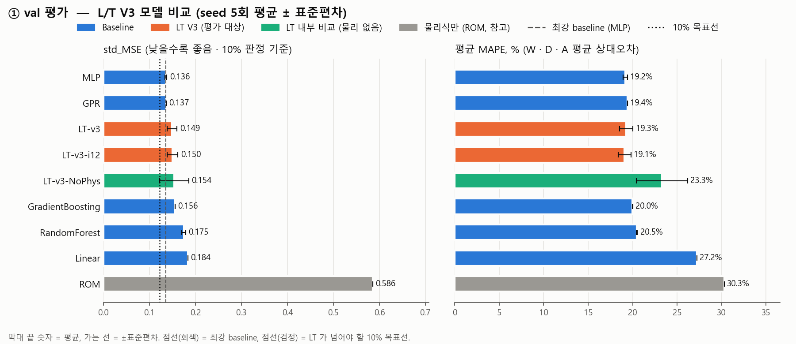
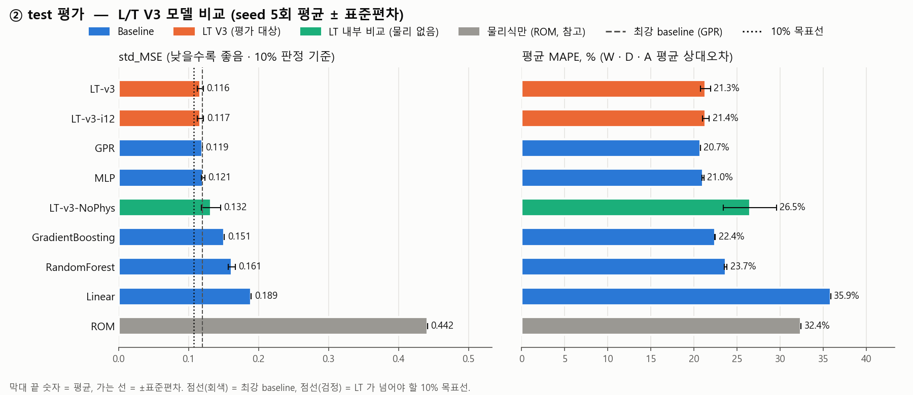
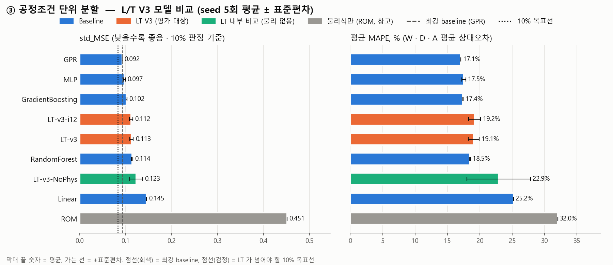
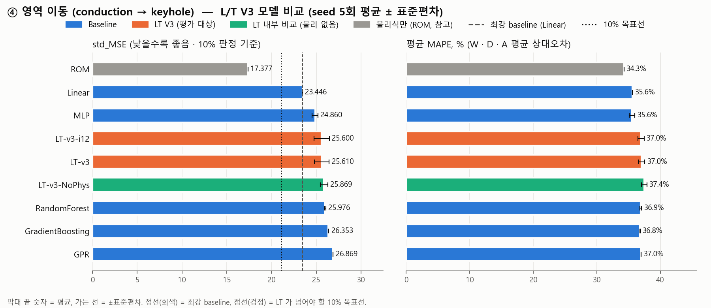
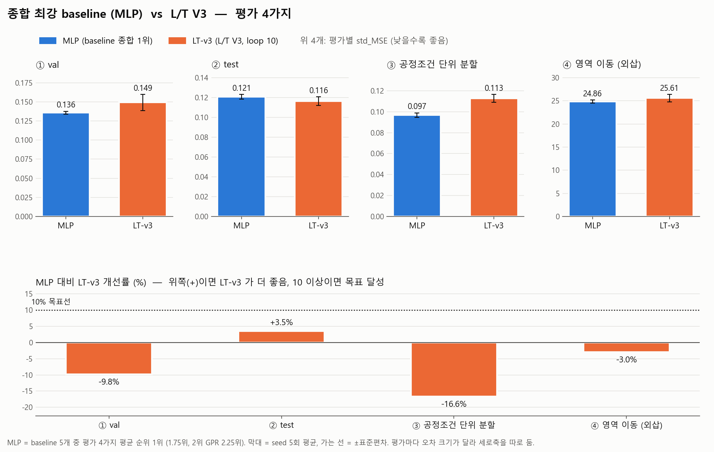

# Baseline 비교 결과 — L/T V3 (4가지 평가 통합)

> V1 (Rosenthal 평가기, loop 3/6/12) 결과는 `../results/results.md` 참고. 이 문서 끝의 "V1 → V3" 표에서 두 버전의 LT 를 비교한다.

## 평가 방식 한눈에
| 평가 | 설명 |
|---|---|
| ① val | 기준이가 나눈 방식 그대로 train 473개로 학습하고 val 101개로 채점. 지금까지 해온 기본 비교 |
| ② test | 같은 train 으로 학습하고, 한 번도 쓰지 않은 test 103개로 채점. val 결과가 우연히 그 시험지에만 잘 맞은 것은 아닌지 확인 |
| ③ 공정조건 단위 분할 | 같은 조건(P, v, d, t)으로 두 번 실험한 쌍이 train/test 에 나뉘지 않게 묶어서 분할. 거의 같은 문제를 미리 보고 맞히는 효과를 뺀 엄격한 평가 |
| ④ 영역 이동 | 얕은 용융풀(conduction, D/W < 0.5)로만 학습하고 깊은 용융풀(keyhole, D/W ≥ 0.5)로 채점. 처음 보는 영역에서도 예측이 버티는지(외삽) 보는 가장 어려운 평가 |

## 공통 실험 조건
- 입력 7개 (P, v, d, t, E_L, Pe, H*) → 출력 3개 (W, R = D/W, A). 표준화 기준은 각 평가의 train 으로만 계산
- 반복: 모델 seed 0~4 로 5회 → 평균 ± 표준편차 (데이터 분할은 평가마다 고정)
- 신경망(MLP, LT): AdamW, lr 1e-3, batch 64, 100 epoch 고정 (평가 데이터로 best epoch 를 고르지 않음)
- LT V3 설정: `looped_transformer_v3.pt` 에 저장된 학습 인자와 같음 (학습 loop 10, fluid 평가기 residual 7개, physics_alpha 0.1).
  단, 체크포인트는 val 기준 조기 종료(patience 20)로 epoch 를 골랐지만 여기서는 위 규칙대로 100 epoch 고정

## 지표
| 지표 | 뜻 |
|---|---|
| std_MSE | 표준화 공간의 평균제곱오차 (W · R · A 평균). 단위가 없어 항목을 합칠 수 있음 → **10% 판정 기준** |
| MAPE (%) | 평균 상대오차. mean_MAPE = W · D · A 의 MAPE 평균 |
| MAE | 평균 절대오차 (W, D: um / A: um^2) |
| 개선률 (%) | (baseline std_MSE − LT std_MSE) / baseline std_MSE × 100. **10 이상이면 목표 달성** |

## 모델
| 모델 | 어떤 모델인가 | 비고 |
|---|---|---|
| Linear | 입력의 가중합으로 예측하는 가장 단순한 기준선 | 무작위성 없음 |
| RandomForest | 결정트리 여러 개의 예측을 평균 | scikit-learn 기본값 |
| GradientBoosting | 앞 트리의 오차를 다음 트리가 보완하며 쌓음 | W, R, A 각각 별도 모델 |
| GPR | 비슷한 입력 → 비슷한 출력 가정(kernel). 소량 데이터에 강함 | RBF + 노이즈 |
| MLP | 3층 신경망 (기준이 `StateMLP`) | LT 와 같은 학습 설정 |
| ROM | 학습 없이 물리식만으로 계산 (Rosenthal W, H*·Pe 깊이, 반타원 A) | 참고용 |
| LT-v3 | Looped Transformer V3. 학습 · 추론 loop 10, 학습 · 추론 모두 fluid 평가기 | **평가 대상** |
| LT-v3-i12 | 같은 학습, 추론만 loop 12 (`interfaceLT.py` 설정) | **평가 대상** |
| LT-v3-NoPhys | 물리 피드백 · 물리 loss 없음 (loop 10) | 내부 비교: LT-v3 과의 차이 = 물리의 효과 |

## 평가 방식 4가지

| 평가 | train | 평가 데이터 | 확인하는 것 |
|---|---|---|---|
| ① val 평가 | 473 | 101 | 기본 비교 (기준이 분할) |
| ② test 평가 | 473 | 103 | val 에만 맞춰진 결과가 아닌지 (한 번도 안 쓴 데이터) |
| ③ 공정조건 단위 분할 | 470 | 104 | 같은 조건 반복 실험을 외워서 맞히는 효과를 뺀 성능 |
| ④ 영역 이동 (conduction → keyhole) | 342 | 335 | 처음 보는 영역에서도 버티는지 (외삽) |

## 종합 1: 평가별 std_MSE (낮을수록 좋음, 평균 ± 표준편차)

| model | ① val 평가 | ② test 평가 | ③ 공정조건 단위 분할 | ④ 영역 이동 (conduction → keyhole) |
|---|---|---|---|---|
| Linear | 0.184 ± 0.000 | 0.189 ± 0.000 | 0.145 ± 0.000 | 23.446 ± 0.000 |
| RandomForest | 0.175 ± 0.004 | 0.161 ± 0.005 | 0.114 ± 0.002 | 25.976 ± 0.075 |
| GradientBoosting | 0.156 ± 0.000 | 0.151 ± 0.000 | 0.102 ± 0.001 | 26.353 ± 0.033 |
| GPR | 0.137 ± 0.000 | 0.119 ± 0.000 | 0.092 ± 0.000 | 26.869 ± 0.000 |
| MLP | 0.136 ± 0.002 | 0.121 ± 0.002 | 0.097 ± 0.002 | 24.860 ± 0.326 |
| ROM | 0.586 ± 0.000 | 0.442 ± 0.000 | 0.451 ± 0.000 | 17.377 ± 0.000 |
| LT-v3 | 0.149 ± 0.011 | 0.116 ± 0.004 | 0.113 ± 0.004 | 25.610 ± 0.817 |
| LT-v3-i12 | 0.150 ± 0.011 | 0.117 ± 0.004 | 0.112 ± 0.004 | 25.600 ± 0.849 |
| LT-v3-NoPhys | 0.154 ± 0.032 | 0.132 ± 0.014 | 0.123 ± 0.014 | 25.869 ± 0.419 |

## 종합 2: 가장 강한 baseline 대비 LT 개선률 (%) — 10 이상이면 목표 달성

| 평가 | 최강 baseline | LT-v3 | LT-v3-i12 |
|---|---|---|---|
| ① val 평가 | MLP | -9.8 | -10.6 |
| ② test 평가 | GPR | 2.5 | 2.2 |
| ③ 공정조건 단위 분할 | GPR | -22.3 | -21.3 |
| ④ 영역 이동 (conduction → keyhole) | Linear | -9.2 | -9.2 |

---

## ① val 평가
기본 비교 (기준이 분할)

### 주요 지표

| model | std_MSE | mean_MAPE | W_MAPE | D_MAPE | A_MAPE | W_MAE | D_MAE | A_MAE |
|---|---|---|---|---|---|---|---|---|
| Linear | 0.1837 ± 0 | 27.23 ± 0 | 10.14 ± 0 | 34.81 ± 0 | 36.74 ± 0 | 15.15 ± 0 | 26.73 ± 0 | 3716 ± 0 |
| RandomForest | 0.1746 ± 0.004 | 20.47 ± 0.068 | 9.911 ± 0.19 | 27.47 ± 0.22 | 24.03 ± 0.42 | 14.96 ± 0.22 | 23.75 ± 0.28 | 3408 ± 53 |
| GradientBoosting | 0.1557 ± 0.00025 | 19.99 ± 0.0079 | 9.71 ± 0.0048 | 25.71 ± 0.021 | 24.55 ± 0.012 | 14.27 ± 0.012 | 20.82 ± 0.046 | 3190 ± 1.2 |
| GPR | 0.1367 ± 0 | 19.41 ± 0 | 9.334 ± 0 | 27.33 ± 0 | 21.57 ± 0 | 14.05 ± 0 | 21.21 ± 0 | 2991 ± 0 |
| MLP | 0.136 ± 0.0019 | 19.16 ± 0.25 | 9.405 ± 0.25 | 27 ± 0.61 | 21.08 ± 0.33 | 14.02 ± 0.28 | 21.32 ± 0.34 | 2999 ± 15 |
| ROM | 0.5858 ± 0 | 30.3 ± 0 | 12.27 ± 0 | 36.45 ± 0 | 42.18 ± 0 | 19.02 ± 0 | 48.15 ± 0 | 8088 ± 0 |
| LT-v3 | 0.1494 ± 0.011 | 19.27 ± 0.76 | 9.606 ± 0.45 | 27.56 ± 0.81 | 20.65 ± 1.2 | 14.22 ± 0.38 | 21.48 ± 0.47 | 3181 ± 38 |
| LT-v3-i12 | 0.1504 ± 0.011 | 19.09 ± 0.71 | 9.686 ± 0.46 | 27.44 ± 0.9 | 20.15 ± 1 | 14.28 ± 0.39 | 21.55 ± 0.51 | 3142 ± 41 |
| LT-v3-NoPhys | 0.1538 ± 0.032 | 23.31 ± 2.9 | 10.34 ± 1.9 | 29.92 ± 2.5 | 29.67 ± 7.9 | 14.97 ± 2 | 22.72 ± 0.85 | 3428 ± 3e+02 |

### baseline 별 LT 개선률 (%)

| baseline | LT-v3 | LT-v3-i12 |
|---|---|---|
| Linear | 18.7 | 18.2 |
| RandomForest | 14.5 | 13.9 |
| GradientBoosting | 4.0 | 3.4 |
| GPR | -9.2 | -10.0 |
| MLP | -9.8 | -10.6 |

---

## ② test 평가
val 에만 맞춰진 결과가 아닌지 (한 번도 안 쓴 데이터)

### 주요 지표

| model | std_MSE | mean_MAPE | W_MAPE | D_MAPE | A_MAPE | W_MAE | D_MAE | A_MAE |
|---|---|---|---|---|---|---|---|---|
| Linear | 0.1895 ± 0 | 35.87 ± 0 | 10.43 ± 0 | 47.2 ± 0 | 49.98 ± 0 | 15.01 ± 0 | 28.2 ± 0 | 3690 ± 0 |
| RandomForest | 0.1615 ± 0.0051 | 23.69 ± 0.15 | 9.393 ± 0.036 | 35.3 ± 0.25 | 26.37 ± 0.48 | 14.17 ± 0.071 | 23.47 ± 0.24 | 3124 ± 42 |
| GradientBoosting | 0.1508 ± 0.00031 | 22.44 ± 0.052 | 8.963 ± 0.035 | 33.26 ± 0.14 | 25.1 ± 0.0049 | 13.7 ± 0.054 | 20.66 ± 0.044 | 2894 ± 0.4 |
| GPR | 0.1194 ± 0 | 20.74 ± 0 | 8.421 ± 0 | 31.16 ± 0 | 22.63 ± 0 | 12.51 ± 0 | 20.87 ± 0 | 2758 ± 0 |
| MLP | 0.1206 ± 0.0025 | 21.05 ± 0.11 | 8.349 ± 0.086 | 33.13 ± 0.24 | 21.65 ± 0.49 | 12.42 ± 0.081 | 21.88 ± 0.46 | 2693 ± 52 |
| ROM | 0.4415 ± 0 | 32.42 ± 0 | 12.04 ± 0 | 41.53 ± 0 | 43.67 ± 0 | 18.38 ± 0 | 46.54 ± 0 | 7545 ± 0 |
| LT-v3 | 0.1164 ± 0.0044 | 21.34 ± 0.57 | 8.721 ± 0.34 | 31.98 ± 0.56 | 23.31 ± 1.2 | 13.05 ± 0.32 | 21.92 ± 0.64 | 2978 ± 56 |
| LT-v3-i12 | 0.1168 ± 0.0044 | 21.38 ± 0.4 | 8.818 ± 0.38 | 31.86 ± 0.6 | 23.46 ± 1 | 13.15 ± 0.38 | 22.03 ± 0.7 | 2976 ± 72 |
| LT-v3-NoPhys | 0.1318 ± 0.014 | 26.52 ± 3.1 | 9.733 ± 1.5 | 33.49 ± 3 | 36.33 ± 9.7 | 14.05 ± 1.4 | 22.42 ± 0.97 | 3342 ± 3.4e+02 |

### baseline 별 LT 개선률 (%)

| baseline | LT-v3 | LT-v3-i12 |
|---|---|---|
| Linear | 38.6 | 38.4 |
| RandomForest | 27.9 | 27.7 |
| GradientBoosting | 22.8 | 22.5 |
| GPR | 2.5 | 2.2 |
| MLP | 3.5 | 3.2 |

---

## ③ 공정조건 단위 분할
같은 조건 반복 실험을 외워서 맞히는 효과를 뺀 성능

### 주요 지표

| model | std_MSE | mean_MAPE | W_MAPE | D_MAPE | A_MAPE | W_MAE | D_MAE | A_MAE |
|---|---|---|---|---|---|---|---|---|
| Linear | 0.1454 ± 0 | 25.2 ± 0 | 10.68 ± 0 | 35.82 ± 0 | 29.08 ± 0 | 14.91 ± 0 | 25.01 ± 0 | 3183 ± 0 |
| RandomForest | 0.1141 ± 0.0016 | 18.47 ± 0.095 | 9.604 ± 0.098 | 26.94 ± 0.12 | 18.86 ± 0.28 | 14.1 ± 0.14 | 21.64 ± 0.2 | 2805 ± 22 |
| GradientBoosting | 0.1019 ± 0.00085 | 17.4 ± 0.047 | 8.907 ± 0.022 | 23.43 ± 0.13 | 19.86 ± 0.049 | 13.19 ± 0.027 | 19.17 ± 0.14 | 2635 ± 4.1 |
| GPR | 0.0923 ± 0 | 17.07 ± 0 | 9.154 ± 0 | 24.26 ± 0 | 17.8 ± 0 | 13.11 ± 0 | 19.51 ± 0 | 2380 ± 0 |
| MLP | 0.09676 ± 0.0022 | 17.51 ± 0.32 | 9.349 ± 0.14 | 25.11 ± 0.44 | 18.06 ± 0.47 | 13.49 ± 0.12 | 20.07 ± 0.19 | 2424 ± 17 |
| ROM | 0.4514 ± 0 | 32.02 ± 0 | 12.97 ± 0 | 37.27 ± 0 | 45.81 ± 0 | 19.53 ± 0 | 44.93 ± 0 | 7995 ± 0 |
| LT-v3 | 0.1128 ± 0.0038 | 19.08 ± 0.84 | 9.805 ± 0.46 | 27.5 ± 1.5 | 19.94 ± 1 | 13.97 ± 0.46 | 20.32 ± 0.74 | 2779 ± 1.2e+02 |
| LT-v3-i12 | 0.112 ± 0.0038 | 19.19 ± 0.94 | 9.861 ± 0.45 | 27.36 ± 1.3 | 20.35 ± 1.7 | 13.98 ± 0.47 | 20.55 ± 0.74 | 2782 ± 1.2e+02 |
| LT-v3-NoPhys | 0.1229 ± 0.014 | 22.9 ± 4.9 | 10.21 ± 1.3 | 30.48 ± 2 | 28 ± 12 | 14.13 ± 1.5 | 22.21 ± 1.8 | 3209 ± 4.6e+02 |

### baseline 별 LT 개선률 (%)

| baseline | LT-v3 | LT-v3-i12 |
|---|---|---|
| Linear | 22.4 | 23.0 |
| RandomForest | 1.1 | 1.9 |
| GradientBoosting | -10.8 | -9.9 |
| GPR | -22.3 | -21.3 |
| MLP | -16.6 | -15.7 |

---

## ④ 영역 이동 (conduction → keyhole)
처음 보는 영역에서도 버티는지 (외삽)

### 주요 지표

| model | std_MSE | mean_MAPE | W_MAPE | D_MAPE | A_MAPE | W_MAE | D_MAE | A_MAE |
|---|---|---|---|---|---|---|---|---|
| Linear | 23.45 ± 0 | 35.62 ± 0 | 17.59 ± 0 | 47.5 ± 0 | 41.76 ± 0 | 27.27 ± 0 | 88.34 ± 0 | 1.083e+04 ± 0 |
| RandomForest | 25.98 ± 0.075 | 36.91 ± 0.14 | 18.03 ± 0.19 | 50.98 ± 0.036 | 41.71 ± 0.36 | 28.22 ± 0.31 | 101.3 ± 0.11 | 1.211e+04 ± 98 |
| GradientBoosting | 26.35 ± 0.033 | 36.8 ± 0.026 | 18.27 ± 0.031 | 49.88 ± 0.06 | 42.24 ± 0.019 | 27.86 ± 0.046 | 99.12 ± 0.15 | 1.244e+04 ± 8.1 |
| GPR | 26.87 ± 0 | 36.98 ± 0 | 19.42 ± 0 | 50.73 ± 0 | 40.78 ± 0 | 30.49 ± 0 | 102 ± 0 | 1.218e+04 ± 0 |
| MLP | 24.86 ± 0.33 | 35.55 ± 0.42 | 18.19 ± 0.33 | 48.82 ± 0.42 | 39.64 ± 0.95 | 27.32 ± 0.58 | 95.51 ± 0.95 | 1.084e+04 ± 3.8e+02 |
| ROM | 17.38 ± 0 | 34.27 ± 0 | 10.44 ± 0 | 43.62 ± 0 | 48.76 ± 0 | 16.54 ± 0 | 81.43 ± 0 | 1.235e+04 ± 0 |
| LT-v3 | 25.61 ± 0.82 | 37.03 ± 0.52 | 17.9 ± 0.87 | 50.23 ± 1.2 | 42.97 ± 1 | 27.75 ± 1.1 | 99.74 ± 2.1 | 1.255e+04 ± 2.9e+02 |
| LT-v3-i12 | 25.6 ± 0.85 | 36.96 ± 0.48 | 17.71 ± 0.93 | 50.31 ± 1.3 | 42.87 ± 1 | 27.53 ± 1.2 | 99.9 ± 2.3 | 1.255e+04 ± 2.9e+02 |
| LT-v3-NoPhys | 25.87 ± 0.42 | 37.45 ± 0.43 | 18.06 ± 2.1 | 50.85 ± 1.5 | 43.44 ± 1.2 | 28.16 ± 2.6 | 100.9 ± 1.5 | 1.275e+04 ± 2.8e+02 |

### baseline 별 LT 개선률 (%)

| baseline | LT-v3 | LT-v3-i12 |
|---|---|---|
| Linear | -9.2 | -9.2 |
| RandomForest | 1.4 | 1.4 |
| GradientBoosting | 2.8 | 2.9 |
| GPR | 4.7 | 4.7 |
| MLP | -3.0 | -3.0 |

---

## V1 → V3: LT std_MSE 비교 (낮을수록 좋음)

| 평가 | V1 LT-3 | V3 LT-v3 | V3 LT-v3-i12 | 최강 baseline |
|---|---|---|---|---|
| ① val 평가 | 0.146 | 0.149 | 0.15 | 0.136 |
| ② test 평가 | 0.117 | 0.116 | 0.117 | 0.119 |
| ③ 공정조건 단위 분할 | 0.116 | 0.113 | 0.112 | 0.092 |
| ④ 영역 이동 (conduction → keyhole) | 26.184 | 25.61 | 25.6 | 23.446 |

---

## 결과 해석 (직접 작성 — report.py 를 다시 실행하면 지워지므로 따로 보관할 것)

### 종합 최강 baseline (MLP) vs L/T V3

MLP = baseline 5개 중 평가 4가지의 평균 순위가 가장 높은 모델 (1.75위, 2위 GPR 2.25위).
평가별 1위 대비 오차 비율의 평균도 MLP 1.03, GPR 1.04 로 MLP 가 가장 작다.

MLP 대비 LT-v3 개선률: val −9.8%, test +3.5%, 공정조건 단위 −16.6%, 영역 이동 −3.0% → 4가지 모두 10% 미달.

**1. 10% 목표: 4가지 평가 모두 미달.**
test 에서만 LT-v3 가 최강 baseline(GPR)보다 2.5% 낮다. 하지만 차이(0.003)가 LT-v3 의 seed 간 표준편차(0.004)보다 작아서 우위라고 보기 어렵다.

**2. V1 → V3: 전체 오차(std_MSE)는 거의 같다.**
평가별 차이가 0.006 이하이고, 영역 이동에서만 26.18 → 25.61 로 조금 낮아졌다. 평가기를 바꿔도 전체 순위는 달라지지 않았다.

**3. 물리의 효과: V3 에서는 4가지 평가 모두 물리를 켠 쪽이 좋다.** (같은 loop 10 기준)

| 평가 | LT-v3 | LT-v3-NoPhys | A_MAPE (LT-v3 / NoPhys) |
|---|---|---|---|
| ① val | 0.149 ± 0.011 | 0.154 ± 0.032 | 20.7% / 29.7% |
| ② test | 0.116 ± 0.004 | 0.132 ± 0.014 | 23.3% / 36.3% |
| ③ 공정조건 단위 | 0.113 ± 0.004 | 0.123 ± 0.014 | 19.9% / 28.0% |
| ④ 영역 이동 | 25.61 ± 0.82 | 25.87 ± 0.42 | 43.0% / 43.4% |

- 물리를 켜면 **면적 A 의 오차가 크게 줄고**(①~③에서 8~13%p), seed 에 따른 흔들림도 작아진다.
- V1 에서는 물리를 켠 쪽이 오히려 나쁜 평가가 있었다 (val 0.146 vs 0.139, 공정조건 단위 0.116 vs 0.108).
- 다만 V3 NoPhys(loop 10)는 V1 NoPhys(loop 3, val 0.139)보다 나쁘다. 차이의 일부는 "물리 없이 loop 를 10번 돌리면 불안정해지는 것"일 수 있다. 유체 피드백, 면적 일관성 피드백, 물리 loss 중 무엇이 기여했는지는 분리 실험이 필요하다 (**추정**).

**4. 추론 loop 12 vs 10: 차이 없음** (std_MSE 차이 0.001 이하). `interfaceLT.py` 의 loop 12 설정은 결과에 거의 영향이 없다.

**5. 영역 이동(외삽)은 여전히 물리식(ROM)이 가장 낫다** (17.38). 모든 학습 모델이 23 이상이다.

---

## 추가 실험 c: 기준이 노트북 방식으로 모델을 고르면 결과가 달라지는가

`select_val.py` — 결과: `select_val/raw.csv`, `summary.csv`

- 방식: 기준이 분할의 train 으로 학습하면서 매 epoch val 데이터 loss 를 재고, 가장 낮은 epoch 의 가중치를 사용 (20 epoch 개선 없으면 중단). 체크포인트 `looped_transformer_v3.pt` 를 만든 방식과 같다.
- epoch 가 있는 신경망(MLP, LT)만 해당. GPR 등은 epoch 가 없어 위 ①② 결과 그대로.
- val 은 epoch 를 고르는 데 쓰였으므로 **val 점수는 부풀려진 값**이고, **test 점수가 실제 성능**이다.

| 모델 | val (선택에 사용, 참고용) | test (실제 성능) | test, 100 epoch 고정 (위 ②) |
|---|---|---|---|
| MLP | 0.133 ± 0.001 | 0.123 ± 0.004 | 0.121 ± 0.003 |
| LT-v3 | **0.117 ± 0.006** | 0.117 ± 0.007 | 0.116 ± 0.004 |
| LT-v3-NoPhys | 0.126 ± 0.017 | 0.134 ± 0.019 | 0.132 ± 0.014 |
| GPR (epoch 없음) | 0.137 | 0.119 | 0.119 |

- **val 로만 보면 LT-v3 가 목표를 넘는다**: 같은 방식의 MLP 대비 12.4% 개선 (0.133 → 0.117).
- **test 에서는 그대로다**: LT-v3 0.117 로 100 epoch 고정(0.116)과 같고, 최강 baseline GPR(0.119) 대비 2.1%, MLP 대비 5.2% 개선 → **10% 미달**.
- 즉 val 기준으로 epoch 를 고르면 val 점수만 좋아지고 실제 성능(test)은 변하지 않는다. 노트북이 출력하는 val 점수로 10% 를 판정하면 성능을 부풀려 보고하게 된다.
- 물리 효과는 이 방식에서도 같다: 물리를 끄면 test 0.117 → 0.134 로 나빠진다.
